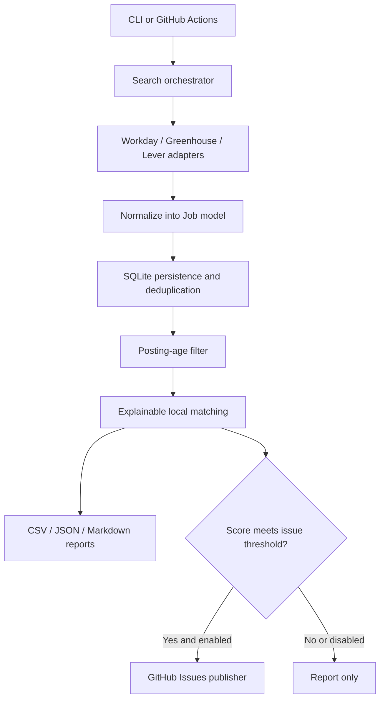

# Job Searcher

A Python job-discovery tool tailored for C++ / Linux / embedded systems roles. It scans configured public career sites, normalizes postings, stores a deduplicated history in SQLite, ranks postings with explainable local keyword evidence, writes reports, and can create one GitHub Issue per qualifying job.

## Current capabilities

- **Workday, Greenhouse, and Lever adapters** using public career-site endpoints. Workday support covers compatible `*.myworkdayjobs.com` sites, not every employer's careers platform.
- **Local relevance scoring** using configured title, location, and skill evidence. The score is a keyword heuristic, not an ATS score or probability of getting an interview.
- **SQLite persistence** with stable source/company/requisition identity, a match cache table, and scan-run history.
- **CSV, JSON, and Markdown reports** uploaded as a GitHub Actions artifact.
- **Optional GitHub Issues notifications** for jobs at or above the configured score threshold. Issues include a stable hidden marker so subsequent runs can avoid creating a second issue for the same job.
- **CI** with Ruff linting and pytest coverage; scheduled scans run on weekdays.

Optional batch-based AI resume matching supports **Gemini**, **Claude**, and any **OpenAI-compatible API endpoint** (including Groq- and OpenRouter-compatible APIs). Local keyword scoring remains the prefilter; AI scoring runs only for the highest-ranked candidates, with a configurable per-scan cap and SQLite caching keyed by job, resume, provider, endpoint, and model. Leave `matching.provider: none` for local-only mode.

## Architecture



## Quick start

Requirements: Python 3.11 or newer.

```bash
python -m venv .venv
# Windows PowerShell: .venv\\Scripts\\Activate.ps1
# macOS/Linux: source .venv/bin/activate
python -m pip install -e ".[dev]"
job-searcher --config config.yml --check-config
job-searcher --config config.yml --output-dir reports
pytest
ruff check src tests
```

The checked-in `config.yml` is pre-populated with a set of Workday career-site URLs and a profile for C++ / Linux / embedded roles. Employer URLs can change; failures are logged per site and do not stop other adapters. Add Greenhouse board tokens or Lever site slugs to their corresponding lists when needed.

The checked-in config defaults to Gemini AI scoring with `gemini-3.5-flash-lite`. Add `GEMINI_API_KEY` and `RESUME_TEXT` as GitHub Actions Secrets before running the scheduled workflow. `RESUME_TEXT` should contain the plain text extracted from your updated PDF; do not commit the PDF or put the binary PDF in a secret. Locally, you can instead set `RESUME_FILE` to an ignored PDF or text file path. To use Claude instead, set `matching.provider: claude` and add `ANTHROPIC_API_KEY`; to use an OpenAI-compatible API, set the repository variable `AI_PROVIDER=openai_compatible`, `AI_BASE_URL` to the API base URL, `AI_MODEL` to the provider model ID, and `AI_API_KEY` as a repository Secret. For example, Groq uses `https://api.groq.com/openai/v1`; OpenRouter uses `https://openrouter.ai/api/v1`. You can change provider, endpoint, model, or key in GitHub settings without editing Python code. To use local-only keyword scoring, set `matching.provider: none`. Override the Gemini model with `GEMINI_MODEL` (default `gemini-3.5-flash-lite`) and Claude with `CLAUDE_MODEL`. The scan is capped at 40 AI-scored jobs by default, in batches of 3. AI requests use a minimum 75-second timeout and retry transient network errors, HTTP 429 rate limits, and HTTP 5xx responses up to three attempts with exponential backoff. Successful scores are cached; failed batches are retried on a later run. The run summary reports partial_ai_failure when any selected AI batch fails.

## GitHub Actions and issue notifications

The scheduled workflow runs on weekdays at 02:17 UTC (07:47 India Standard Time, subject to GitHub scheduling delays) and can be started manually from **Actions → Scheduled job scan → Run workflow**. It installs the package, validates configuration, scans sources, and uploads reports for 14 days.

The checked-in configuration enables GitHub Issues notifications. The workflow passes the built-in `GITHUB_TOKEN` and repository name and declares `issues: write`. If you run locally, set:

```bash
# Linux/macOS
export GITHUB_TOKEN="a-token-with-issues-write-permission"
export GITHUB_REPOSITORY="owner/repository"
```

On Windows PowerShell, use `$env:GITHUB_TOKEN="..."` and `$env:GITHUB_REPOSITORY="owner/repository"`. Never commit tokens. If no token or repository is configured, the scan still creates reports and records notifications as not configured.

An issue is considered only when the local score reaches `matching.threshold` (65 by default). Existing issues are identified by a hidden stable marker. GitHub does not provide an atomic create-if-absent operation, so an external concurrent issue creator could still race; the scheduled workflow itself serializes scans.

## Configuration

Edit `config.yml`:

- `profile.titles`, `profile.locations`, and `profile.skills` define relevance evidence.
- `search.posted_within_days` excludes postings with a known older timestamp. If a source does not expose a parseable date, the posting is retained rather than silently discarded.
- `search.max_pages_per_source` limits listing pages per configured source/site.
- `matching.threshold` controls issue eligibility; it does not control whether a posting appears in reports.
- `notifications.github_issues` enables or disables issue creation.
- `storage.path` sets the local SQLite database path.

Workday detail requests are capped per career site to reduce load; postings beyond that detail cap may have only listing-level fields. Check the report and original posting before applying.

## Privacy and limits

- Never commit real resumes, tokens, `.env` files, SQLite databases, or generated personal reports.
- In AI mode, resume text and selected job-description fields are sent to the configured AI provider for matching. Review that provider's privacy and retention terms before enabling it.
- Public career APIs can change, rate-limit, or return incomplete results. This tool is not a universal crawler; it does not bypass authentication, CAPTCHAs, or access controls.
- Review each job description and employer requirements manually. A high keyword score does not guarantee suitability.

See [Setup and operations](docs/SETUP.md) and [Roadmap](docs/ROADMAP.md).
