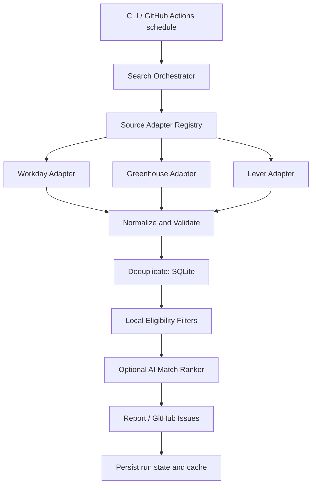
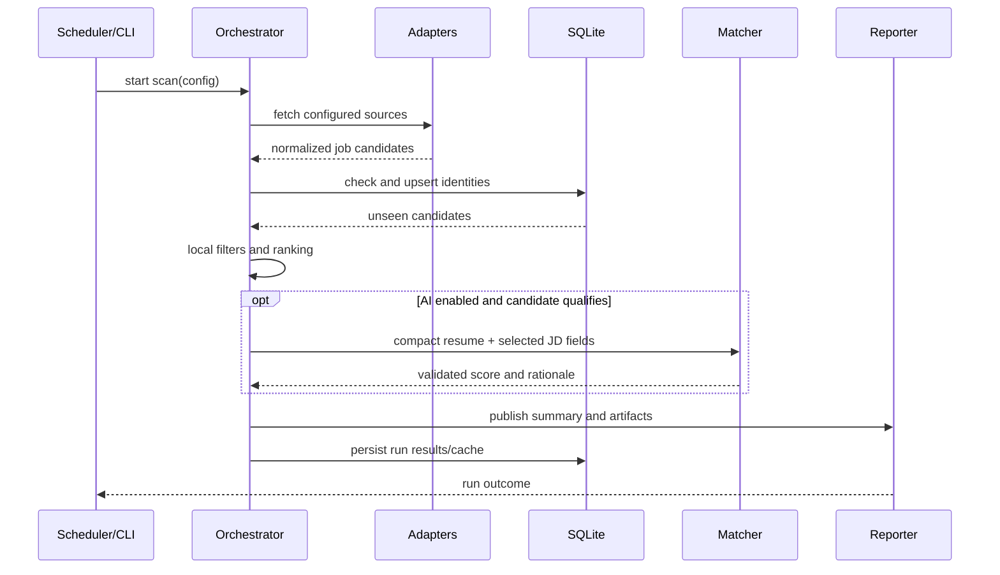

# Job Searcher

A modular, low-token job discovery and matching platform. The initial repository is empty; this commit establishes the product direction and architecture. The implementation will use source adapters, deterministic filtering, normalized job records, persistent deduplication, optional AI ranking, and GitHub-based reporting.

## Design principles
- Source adapters are isolated and independently testable.
- Prefer official public career-site APIs/feeds; do not bypass logins, CAPTCHAs, or access controls.
- Normalize all postings into one schema and deduplicate by source + requisition/URL.
- Apply cheap local filters before any optional AI calls.
- Persist state in SQLite; keep credentials in environment variables/GitHub Secrets.
- Treat coverage as adapter-based, not a promise to crawl every job site.

## Architecture


## Sequence


## Planned structure
```text
src/job_searcher/
  cli.py                 CLI entry point
  config.py              Validated configuration
  models.py              Normalized Job model
  orchestrator.py        Pipeline coordination
  storage/sqlite.py      Persistence and deduplication
  adapters/base.py       Adapter contract
  adapters/greenhouse.py Greenhouse public job boards
  adapters/lever.py      Lever public postings
  adapters/workday.py    Workday career sites
  matching/local.py      Token-efficient local relevance score
  reporting/markdown.py  Reports
 tests/                  Unit and adapter tests
 docs/                   Architecture and operations
 .github/workflows/      Scheduled scans and CI
```

## Status
Bootstrap only. See `docs/ROADMAP.md` for the phased implementation plan. Never commit resume files, API keys, or generated personal reports.
